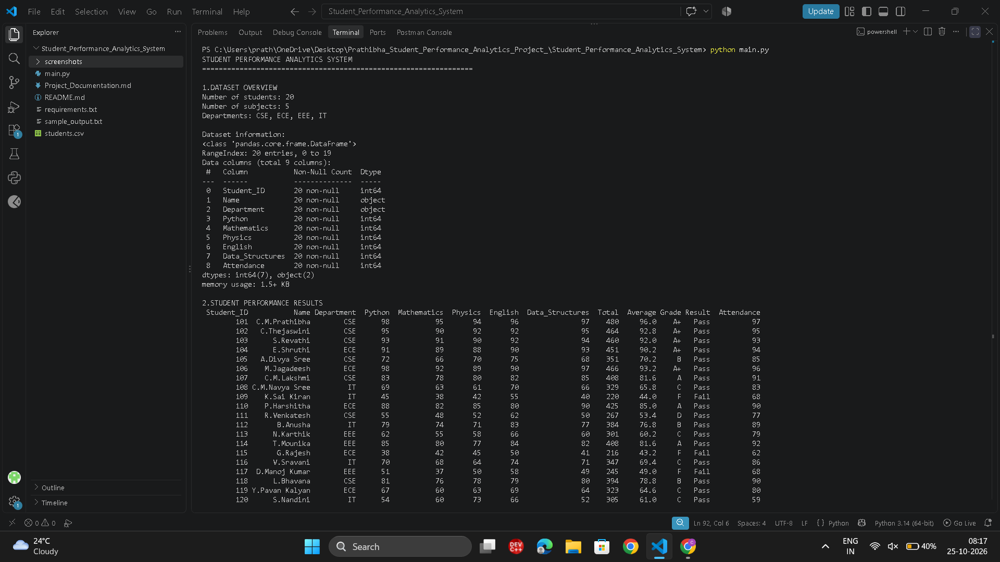
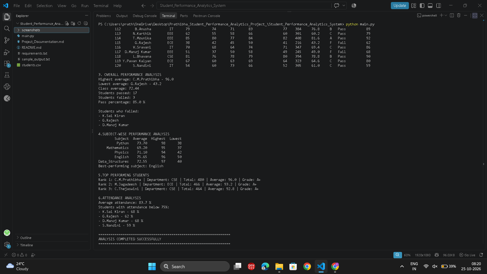

# Student Performance Analytics System

**Student:** C.M. Prathibha  
**Project:** Python Mini Project — Student Performance Analytics System

## 1. Objective

To analyse student marks and attendance using Python, NumPy, and Pandas. The program calculates total marks, average marks, grades, pass/fail results, overall class performance, subject-wise performance, top-performing students, and attendance analysis.

## 2. Technologies Used

- Python
- NumPy
- Pandas
- CSV Dataset
- Git and GitHub
- Visual Studio Code

## 3. Project Files

```text
Student-Performance-Analytics-System/
│
├── main.py
├── students.csv
├── requirements.txt
├── README.md
├── Project_Documentation.md
├── sample_output.txt
└── screenshots/
    ├── performance_analysis.png
    └── students_results.png.png
```

## 4. Dataset Description

The project uses `students.csv`, which contains 20 student records.

The dataset includes:

- Student ID
- Student Name
- Department
- Python marks
- Mathematics marks
- Physics marks
- English marks
- Data Structures marks
- Attendance percentage

## 5. Features

- Reads student data from a CSV file using Pandas.
- Calculates total and average marks using NumPy.
- Assigns grades based on student performance.
- Identifies pass and fail students.
- Calculates the overall class average and pass percentage.
- Displays the highest and lowest student averages.
- Performs subject-wise performance analysis.
- Identifies the best-performing subject.
- Displays the top three performing students.
- Analyses student attendance and identifies students with attendance below 75%.
- Checks for missing columns, invalid marks, and invalid attendance values.

## 6. Grading Rules

A student passes only when every subject mark is at least 40. If any subject mark is below 40, the student's result is **Fail** and the grade is **F**.

For students who pass, grades are assigned according to their average marks:

| Average Marks | Grade | Result |
|---|---|---|
| 90 and above | A+ | Pass |
| 80 to below 90 | A | Pass |
| 70 to below 80 | B | Pass |
| 60 to below 70 | C | Pass |
| Below 60 | D | Pass |

## 7. Installation and Execution

### Step 1: Install Python

Download and install Python 3 from the official website:

https://www.python.org/downloads/

### Step 2: Open the Project Folder

Open the project folder in Visual Studio Code and open its terminal.

### Step 3: Install Required Packages

Run the following command:

```bash
python -m pip install -r requirements.txt
```

### Step 4: Run the Program

Execute the Python program using:

```bash
python main.py
```

The program reads `students.csv`, validates the dataset, and displays the student performance analysis in the terminal.

## 8. Sample Output

The program displays:

- Dataset overview
- Student-wise marks, totals, averages, grades, and results
- Overall class performance
- Pass and fail statistics
- Subject-wise averages, highest marks, and lowest marks
- Best-performing subject
- Top three performing students
- Attendance analysis

The complete sample output is available in `sample_output.txt`.

## 9. Screenshots

### Student Results



### Performance Analysis



These screenshots show the student-wise results and the performance analysis generated by the program.

## 10. Project Outcome

This project demonstrates the use of Python, NumPy, and Pandas to analyse student academic performance. It helps calculate marks, assign grades, identify top performers, compare subject averages, and analyse attendance.

## 11. GitHub Repository

**Project Repository:**  
[Student Performance Analytics System — View on GitHub](https://github.com/chakramalluriprathibha/Student-Performance-Analytics-System)

**Repository URL:**  
https://github.com/chakramalluriprathibha/Student-Performance-Analytics-System

## 12. Submission

The GitHub repository link is provided above for project submission and reference.
